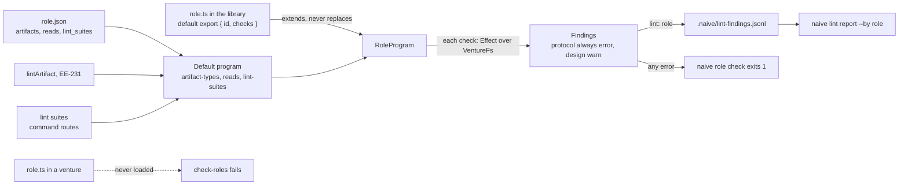
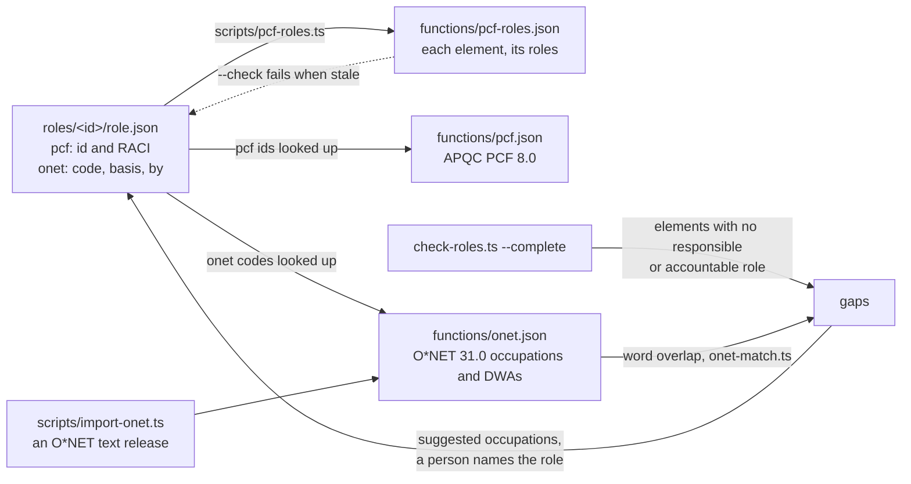

# roles

Up: [src](../README.md)

## What this is

The role library (EE-229): every role Naive knows, agent or person, as one module. A role is a folder holding `role.json`, a record that [`role.schema.json`](../records/role.schema.json) governs, and a short SKILL.md that tells an agent how to act in the role or how to work with the person who holds it. `kind` says who may hold the role: `agent`, `person` or `either`. An agent or either role carries what delegation needs (its function, the decision classes it may be granted, its default tier, its lint suites, its verifier and its skill); a person role carries what governance needs (`person_kind`, `founder`, `owns_when_solo`). A role with a `portfolio` is a lead. The library replaced the role templates under the venture template and the two role registers, which are archived in [`docs/archive/roles-2026-11/`](../../../../docs/archive/roles-2026-11/README.md).

A venture's own roles live at `<venture>/governance/roles/<id>/role.json` and overlay the library by id: a venture role with a library role's id replaces it, and any other id adds a role. Naive's own roles, the ones that build Naive itself, live at [`agents/<id>/`](../../../../agents/README.md) in the same shape and overlay the library for Naive alone (EE-238). A role in either overlay may name a library role in `extends` and leave out every field it inherits but its aliases, so what the two share has one source: Naive's product-manager extends `product-design-lead`, whose alias is product-manager.

## Where things are

| Path | Holds |
|---|---|
| `<id>/role.json` | One role: id, name, kind, description and the fields for its kind |
| `<id>/SKILL.md` | How an agent works in the role, or with the person in it |
| `<id>/role.ts` | Optional: more checks of what the role makes, added to its program (EE-237). `architect/role.ts` and `product-design-lead/role.ts` are the two so far |

The roles: `architect`, `builder`, `chief-of-staff`, `domain-lead`, `finance-agent`, `finance-lead`, `growth-lead`, `marketing-lead`, `people-lead`, `product-design-lead`, `product-lead`, `strategy-lead` and `validation-lead` are agent roles; `counsel` is either; `founder`, `co-founder`, `general-partner`, `limited-partner`, `operator`, `advisor` and `board-member` are person roles.

Strategy process group roles (EE-239): `business-intelligence-analyst` (1.1), `management-analyst` (1.2), `project-management-specialist` (1.3), `financial-and-investment-analyst` (1.4), each accountable for one APQC process group and named after its closest O*NET occupation.

Products process group roles (EE-240): `architectural-and-engineering-manager` (2.1), each accountable for one APQC process group and named after its closest O*NET occupation.

Marketing and sales process group roles (EE-241): `market-research-analyst` (3.1), `advertising-and-promotions-manager` (3.3), `sales-manager` (3.4), `sales-representative-of-services` (3.5), each accountable for one APQC process group and named after its closest O*NET occupation.

Supply chain process group roles (EE-242): `supply-chain-manager` (4.1), `purchasing-agent` (4.2), `industrial-production-manager` (4.3), `logistician` (4.4), each accountable for one APQC process group and named after its closest O*NET occupation.

Service delivery process group roles (EE-243): `general-and-operations-manager` (5.1), `operations-research-analyst` (5.2), `administrative-services-manager` (5.3), `business-operations-specialist` (5.4), each accountable for one APQC process group and named after its closest O*NET occupation.

Process group roles for customer-service (EE-244), one accountable for each of 6.1 to 6.5: `customer-service-representative`, `claims-adjuster` and `survey-researcher` are agent roles; `customer-service-management-analyst` and `regulatory-affairs-specialist` are either.

Process group roles for human-capital (EE-245), one accountable for each of 7.3 to 7.8: `training-and-development-specialist` and `human-resources-assistant` are agent roles; `labor-relations-specialist`, `compensation-and-benefits-manager`, `human-resources-specialist` and `internal-public-relations-specialist` are either.

Process group roles for it (EE-246), one accountable for each of 8.1 to 8.7: `computer-systems-analyst`, `information-security-analyst`, `database-architect`, `computer-systems-engineer`, `information-technology-project-manager` and `network-and-computer-systems-administrator` are agent roles; `computer-and-information-systems-manager` is either.

Process group roles for assets (EE-248), one accountable for each of 10.1 to 10.4: `facilities-manager` (10.1), `construction-manager` (10.2), `first-line-supervisor-of-mechanics-installers-and-repairers` (10.3) and `appraiser-of-personal-and-business-property` (10.4). The construction manager and the first-line supervisor are agent roles; the facilities manager and the appraiser are either.
Process group roles for finance (EE-247, roles plan step 11), each accountable for one APQC level 2 process group and named after its O*NET match: `budget-analyst`, `billing-and-posting-clerk`, `accountant`, `financial-analyst`, `payroll-clerk`, `bookkeeping-clerk`, `treasurer`, `auditor`, `tax-preparer`, `controller` and `customs-broker`.

## Role programs

Every role has a program (EE-237, [`role-program.ts`](../checks/role-program.ts)): deterministic checks of what the role makes, each an Effect over `VentureFs` that fails only with Naive's tagged errors. The default program comes from `role.json`:

- `artifact-types`: each of its `artifacts` is a record type or a document kind (`artifactKind`), and in a venture each artifact record of a kind the role names, made by it or by no named role, passes the artifact lint (`lintArtifact`) with that rule's family and level.
- `reads`: each record type it reads is in the data model, and in a venture a record of it exists (a warning when none does).
- `lint-suites`: each of its `lint_suites` is a command route, and in a venture each suite runs; its findings warn, or fail when the suite's rule is fail-closed.

A library role may add checks in `role.ts`, a default export `{ id, checks }` whose id is the role's. They run after the default ones and may not reuse a default check's id, so `role.ts` extends the program and never replaces it. `architect/role.ts` requires every `adr` artifact to be built from a decision record the venture has. `product-design-lead/role.ts` warns on a live or building product capability that names no goal and fails on a goal it names that the venture lacks.

Naive loads only the library's `role.ts`, never one in a venture's `governance/roles/<id>/`: the venture folder is data that agents write and sync copies, and importing its code would run it with the CLI's rights outside the gate. A venture role's program is the default one for its `role.json` plus the library's `role.ts` of the same id.

## Run and test

- `node packages/naive/src/checks/check-roles.ts [venture dir] [--json]` checks the library and, with a venture, its overlay, or with none Naive's own roles under `agents/`: every file validates, its id matches its folder, `verified_by` and each `also_verified_by` name a known role and never the role itself, ids and aliases are unique, a person role grants no agent tier, each library `role.ts` exports a valid program whose id is its role's, and no venture role has a `role.ts`.
- It also checks the links to APQC's framework and O*NET (EE-232): each `pcf[].id` is a hierarchy id in [`pcf.json`](../functions/pcf.json), named once per role; at most one role is accountable for an element, across the library and a venture's overlay; an accountable role is in the element's function or is a lead whose portfolio covers it; and each `onet[].code` is an occupation in [`onet.json`](../functions/onet.json) with the same title.
- `node packages/naive/src/checks/check-roles.ts [venture dir] --complete [--level <n>]` also fails on each element of levels 1 to `--level` (2 by default) under a function the business runs (all 13, or the venture's `venture.json` departments) that no role is responsible or accountable for, and suggests three O*NET occupations for it by word overlap ([`onet-match.ts`](../engine/onet-match.ts)). A suggestion is a lead for a person, never a match.
- `node scripts/pcf-roles.ts` writes [`pcf-roles.json`](../functions/pcf-roles.json), the element side of the links, from every role's `pcf` field; `node scripts/pcf-roles.ts --check` fails when it is stale.
- `naive role check <role> [--venture <dir>] [--json]` and `naive role check --all` run programs (`node packages/naive/src/checks/role-check.ts <role> [<venture dir>] [--json]`), append every finding to `.naive/lint-findings.jsonl` with lint `role`, and exit 1 on any error. With no venture only the checks that need none run and nothing is logged. `node packages/naive/src/checks/role-program-test.ts` tests the programs over an in-memory `VentureFs`.
- `node packages/naive/src/checks/check-roles-test.ts` breaks each rule on a copy of the library, and `node packages/naive/src/engine/generators/pcf-roles-test.ts` tests the element side. `node test.ts` runs them, the stale check included, and `naive check` runs the check on a venture.
- `node packages/naive/src/checks/check-delegation.ts [venture dir]` checks what delegation needs from the roles: a verifier for every role that is not a person's, grantable classes, and leads' portfolios covering the 13 functions once each.

## How it connects

A role names the PCF elements it answers for and the O*NET occupations it matches; the element side is generated from the role side, so the link is held both ways (EE-232).

Today the four leads are accountable for the categories in their portfolios, each function role is responsible for its function's category and for the process groups its description plainly covers, and six roles name the O*NET occupation their title matches, each with its basis and who matched it. `--complete` reports 67 of the 74 process groups as gaps; every category has an accountable role.

- Read through [`loadRoles`, `knownRoles` and `isPersonRole`](../engine/agents/roles.ts), the one loader. Every reader goes through it: delegation, team plans, lead plans, the routing rule, element owners, the decision queue, detectors, publication and people checks.
- Records that name a role: decision rights owners, delegation grants, team plans, lead plans (`operations/lead/[id]`), element owners (`operations/element-owners`), handoffs and detectors.

## Not built

- The fields later steps fill (`reads`, `artifacts`, `standards`, `research`, `level`) are in the schema and empty in every library role, except the `reads` and `artifacts` of the architect and the product and design lead (EE-237); Naive's own roles under `agents/` fill them (EE-238), and `check-roles.ts` checks each artifact, the kinds only one role makes (`made_by` in `documents.json`) and each standard. Linking roles to deployments is not built.
- A role for each of the 67 process groups with no responsible or accountable role is not built (step 11 of the roles plan). The person roles link to no PCF element.
- Setting a role program's own design rules (`reads-present`, a `role.ts` warning) off, warn or error is not built: they always warn. The artifact lint's design rules follow `artifact_lint.rules`, and a lint suite's findings follow that suite's own rule modes.
- `recordsOf`, which a `role.ts` uses to read a record type's files, reads only paths whose folder has no wildcard.
