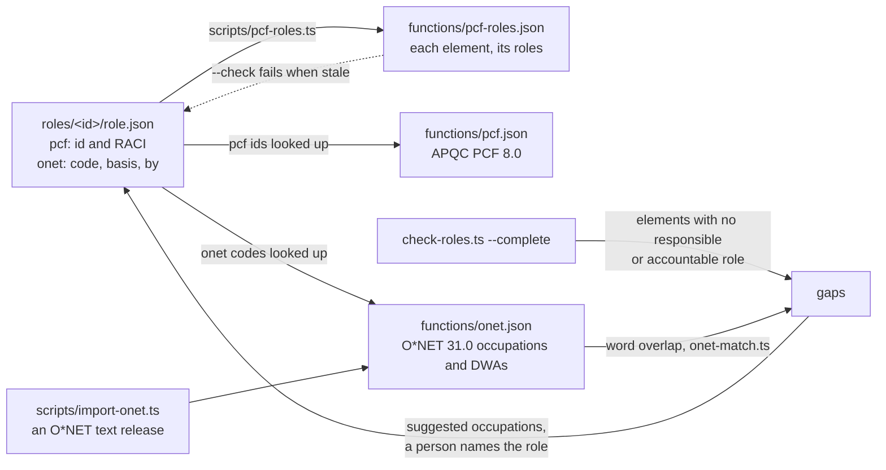

# roles

Up: [src](../README.md)

## What this is

The role library (EE-229): every role Naive knows, agent or person, as one module. A role is a folder holding `role.json`, a record that [`role.schema.json`](../records/role.schema.json) governs, and a short SKILL.md that tells an agent how to act in the role or how to work with the person who holds it. `kind` says who may hold the role: `agent`, `person` or `either`. An agent or either role carries what delegation needs (its function, the decision classes it may be granted, its default tier, its lint suites, its verifier and its skill); a person role carries what governance needs (`person_kind`, `founder`, `owns_when_solo`). A role with a `portfolio` is a lead. The library replaced the role templates under the venture template and the two role registers, which are archived in [`docs/archive/roles-2026-11/`](../../../../docs/archive/roles-2026-11/README.md).

A venture's own roles live at `<venture>/governance/roles/<id>/role.json` and overlay the library by id: a venture role with a library role's id replaces it whole, and any other id adds a role.

## Where things are

| Path | Holds |
|---|---|
| `<id>/role.json` | One role: id, name, kind, description and the fields for its kind |
| `<id>/SKILL.md` | How an agent works in the role, or with the person in it |

The roles: `architect`, `builder`, `chief-of-staff`, `domain-lead`, `finance-agent`, `finance-lead`, `growth-lead`, `marketing-lead`, `people-lead`, `product-design-lead`, `product-lead`, `strategy-lead` and `validation-lead` are agent roles; `counsel` is either; `founder`, `co-founder`, `general-partner`, `limited-partner`, `operator`, `advisor` and `board-member` are person roles.

## Run and test

- `node packages/naive/src/checks/check-roles.ts [venture dir] [--json]` checks the library and, with a venture, its overlay: every file validates, its id matches its folder, `verified_by` and each `also_verified_by` name a known role and never the role itself, ids and aliases are unique, and a person role grants no agent tier.
- It also checks the links to APQC's framework and O*NET (EE-232): each `pcf[].id` is a hierarchy id in [`pcf.json`](../functions/pcf.json), named once per role; at most one role is accountable for an element, across the library and a venture's overlay; an accountable role is in the element's function or is a lead whose portfolio covers it; and each `onet[].code` is an occupation in [`onet.json`](../functions/onet.json) with the same title.
- `node packages/naive/src/checks/check-roles.ts [venture dir] --complete [--level <n>]` also fails on each element of levels 1 to `--level` (2 by default) under a function the business runs (all 13, or the venture's `venture.json` departments) that no role is responsible or accountable for, and suggests three O*NET occupations for it by word overlap ([`onet-match.ts`](../engine/onet-match.ts)). A suggestion is a lead for a person, never a match.
- `node scripts/pcf-roles.ts` writes [`pcf-roles.json`](../functions/pcf-roles.json), the element side of the links, from every role's `pcf` field; `node scripts/pcf-roles.ts --check` fails when it is stale.
- `node packages/naive/src/checks/check-roles-test.ts` breaks each rule on a copy of the library, and `node packages/naive/src/engine/generators/pcf-roles-test.ts` tests the element side. `node test.ts` runs them, the stale check included, and `naive check` runs the check on a venture.
- `node packages/naive/src/checks/check-delegation.ts [venture dir]` checks what delegation needs from the roles: a verifier for every role that is not a person's, grantable classes, and leads' portfolios covering the 13 functions once each.

## How it connects

A role names the PCF elements it answers for and the O*NET occupations it matches; the element side is generated from the role side, so the link is held both ways (EE-232).

Today the four leads are accountable for the categories in their portfolios, each function role is responsible for its function's category and for the process groups its description plainly covers, and six roles name the O*NET occupation their title matches, each with its basis and who matched it. `--complete` reports 67 of the 74 process groups as gaps; every category has an accountable role.

- Read through [`loadRoles`, `knownRoles` and `isPersonRole`](../engine/agents/roles.ts), the one loader. Every reader goes through it: delegation, team plans, lead plans, the routing rule, element owners, the decision queue, detectors, publication and people checks.
- Records that name a role: decision rights owners, delegation grants, team plans, lead plans (`operations/lead/[id]`), element owners (`operations/element-owners`), handoffs and detectors.

## Not built

- The fields later steps fill (`reads`, `artifacts`, `standards`, `research`, `level`) are in the schema and empty in every role; linking roles to artifacts and deployments is not built.
- A role for each of the 67 process groups with no responsible or accountable role is not built (step 11 of the roles plan). The person roles link to no PCF element.
