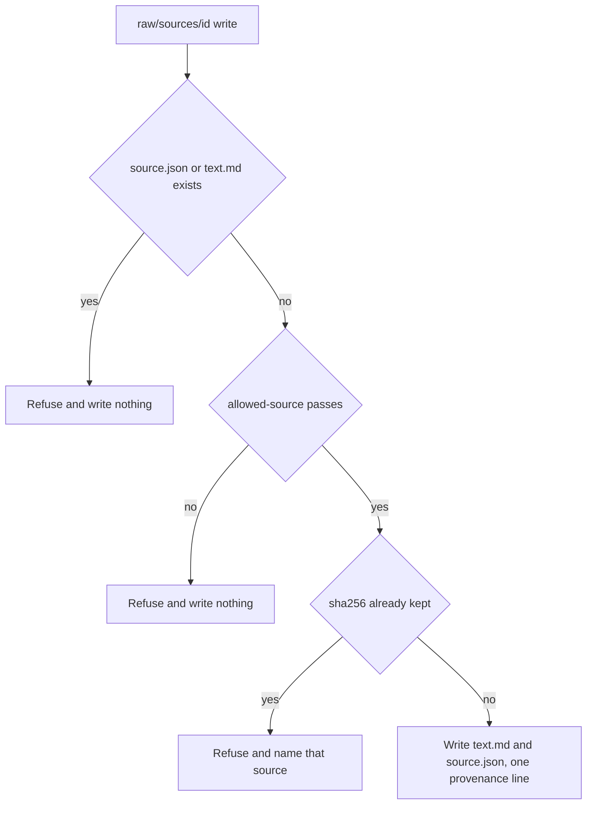

# router

Up: [src](../README.md)

## What this is

The routes' actions, shared by the CLI, the MCP server and the HTTP API (EE-030). Routes follow the Next.js App Router (EE-032). The route table itself is generated in [`packages/naive/src/records/routes`](../records/routes/README.md); renamed routes keep resolving through `route-aliases.json`.

A write whose record has a `venture` field naming another venture is refused before the schema check, so a record carried over from one venture is never filed under another.

## Where things are

| Path | Holds |
|---|---|
| [`agent-files.ts`](./agent-files.ts) | The agent filesystem (EE-122): `ls`, `read`, `write`, `edit`, `glob` and `grep` over the router, for deep agents. A path is a route with a leading slash, a file is a record as JSON, and every write meets the schema, the gate and provenance, so a gated agent write comes back as a draft. Each operation is a tool span when traces are on. No LangChain import; an app wraps it as a deepagents backend. With `reads_as_of` in the context, every operation reads as of that time ([`reads-as-of.ts`](./reads-as-of.ts)); a researcher role must give one. A recipe file, `/<pattern>.recipe.ts`, is not a record route: `read` gives the tip's source, and `write` and `edit` go to `recipes/<pattern>` with `{ source, base }` (an edit's base is the tip it read, a whole-file write's the tip as it is), so every recipe write is scored and an agent's keep is held. |
| [`acting.ts`](./acting.ts) | Who is acting (M-18, like cookies in a Server Action) and access on every read (F-5). It holds the signal projector's identity: `asProjector(args)` makes a call as the agent `projector` and adds a symbol no JSON can carry, so no CLI flag, MCP tool, HTTP body or `MENTURA_ACTOR_ID` can claim it, and the role id `projector` is refused on any call without it. Only router code may call `asProjector`: the signal pull in [`orchestration/signals.ts`](./orchestration/signals.ts) does. |
| [`boundaries.ts`](./boundaries.ts) | Error boundaries (Next.js translation P-15, E-5, E-6, E-8). The framework files it checks first include the five phase modules (`packages/naive/src/phases/<id>/phase.json`). Hosted without a git working copy, a broken `venture.json`'s recovery says restoring it from git is refused. |
| [`brand.ts`](./brand.ts) | The brand and asset verbs of the CLI (mentura brand ..., mentura assets ...). |
| [`context.ts`](./context.ts) | Context. |
| Blobs | Every write the router records passes its content to provenance, which keeps the bytes under `.naive/blobs/` before appending the line, so `readAsOf` in [`../store/as-of.ts`](../store/as-of.ts) can return a record as it was at a time. Writes to other sources and attribute writes pass the content they wrote. |
| [`appends.ts`](./appends.ts) | The router's `append` action: one hash-chained line added to a log route (today only `governance/detector-trial/<id>`). The router chains the line onto the log's last line, checks it against the schema, applies the gate, and appends with the version it read, so a line another writer added in between is never skipped; with the caller's `base` it refuses a stale one and returns the current version. Every line is a provenance entry. |
| [`detection-ledger.ts`](./detection-ledger.ts) | The detection ledger through the router (signal detection, build item 4): `appendTrial`, `resolveTrial` (refused for an unknown trial, one already resolved, or an outcome its call cannot have, checked and appended as one step), `read`, `verify` (the chain and the shape) and `unresolvedNoCall`. Never resolves on a timeout. Tested by [`detection-ledger-test.ts`](./detection-ledger-test.ts), with parallel writers in separate processes. |
| [`handoff-brief.ts`](./handoff-brief.ts) | The handoff brief through the router (handoff contract v2): a write of `operations/handoff/<id>` may carry the Markdown brief as `brief_text` beside the record's fields. `splitBrief` takes it out before the schema, so it is never stored in the record, and `briefPath` places it at the file the record's `brief` names, which must be a `.md` file in the handoff's own folder. The router writes the record first, then the brief, with its own provenance line naming the record in `derived_from`, and answers `brief: { written, provenance }`. It refuses brief_text that is empty, a brief outside the folder, a brief for a handoff already claimed (the brief stays as it was claimed), a handoff kept in another source, and a write the gate would hold as a draft, because the brief has no draft of its own: then nothing is written. `check-ready.ts --record` still writes `ready_check` into the record directly, not through the router. |
| [`handoff-claim.ts`](./handoff-claim.ts) | The handoff claim (lead agents, build plan item 5): `claimHandoff`, the router's `claim` action on `operations/handoff/<id>`. It succeeds only when the handoff is `ready`, unclaimed and its `role` is the acting role, and sets `claimed_by` (the run id from the call's session, else the acting role) and `status` `in-progress` in one write that names the version it read, so of two racing claims exactly one lands and the other is refused as already claimed. `handoffWriteRule` governs every write of a handoff that names `requested_by`: before a claim only the requester edits it and no plain write claims it; after one only the claimant writes progress and evidence (`PROGRESS`) and only the requester writes the verification and acceptance or sends it back (`VERIFY`). A handoff without `requested_by` is written as before, and a person may write any handoff. It is `.mjs` because every handoff write passes through it, and Node strips no types under node_modules. |
| [`raw-source.ts`](./raw-source.ts) | `raw/sources/[id] write` takes `{ source, text }` and writes `source.json` and `text.md` together, then one provenance line (EE-192). The router sets sha256 from the text. A second write, or a text whose sha256 is already kept, is refused and nothing is written. A denied host or a logged-in fetch is refused by allowed-source. |
| [`router.ts`](./router.ts) goal ledger hook | Goals are durable records (EE-210), so the write path asks [`../engine/goals.ts`](../engine/goals.ts) about every goal write. `goalWriteRefusal` refuses, before the schema, a status change the lifecycle does not allow (nobody, a person included, moves a settled goal anywhere but back to active) and an agent that rewords a goal a person adopted, naming the supersede path instead. `goalSettles` joins the rule that only a person settles a decision (EE-058): an agent's write that changes where a goal stands (`status`, `status_by`, `status_at`, `result`, `superseded_by`) is a draft whatever the goal's class, so a person accepting the draft is the person's act. An agent proposing a goal is not settling one, and a remote source is left to its own connector. |
| [`router.ts`](./router.ts) raw rule | The write path refuses to rewrite a raw record once it exists: `idea-dump`, `raw-text`, `raw-dump` and `triage` (raw triage build item 1, `docs/design/RAW_TRIAGE_2026-11-09.md`). A raw source is the same rule, in [`raw-source.ts`](./raw-source.ts), and it also refuses when `text.md` is already there. A new capture or run is a new file |
| [`write-effects.ts`](./write-effects.ts) | The router's write steps as Effects (EE-161, phase 8): `schemaFailure` checks a record through `RecordValidator` ([`../records/record-validator.ts`](../records/record-validator.ts)) in place of a scratch file, and `logWrite` logs through the `Provenance` service ([`../core/effect/provenance.ts`](../core/effect/provenance.ts)); `gateWrite` in `gate-hooks.ts` asks the gate through `Gate` ([`../engine/gate-service.ts`](../engine/gate-service.ts)) as `gateWriteEffect`. `router.ts` runs each with `runSync` and keeps its exported shapes. The rest of a write (drafts, attributes mastered elsewhere, another source) is still plain async code (not built). `write-effects-test.ts` tests each step and that a provided service replaces it. |
| [`gate-hooks.ts`](./gate-hooks.ts) | The router's hooks into the gate group (X-1 to X-6, P-2, P-7, U-4), and `ledgerHook`: with `governance/detectors/gate-confidence.json` in the venture, the gate's confidence call on an agent's write is a trial, accepting its held draft resolves a false alarm, and a person's revert (provenance activity `rollback`) of a passed write resolves a miss. Without the file it does nothing. `ownerOfWrite` applies one writer per file on every write and append, local or remote, before the schema: a record type with `writer: "projection"` in the data model (`competitors/<id>/signals.json`) is written only by the projector, everyone else is refused with the hint to emit a superseding signal, and the projector writes no record a person owns once it exists. The projector's write to a projection record is never held as a draft. A record type with `writer: "person"` (a function's research program, `programs/<function>.md`) is written only by a person: every agent, a `<function>-researcher` included, is refused (rule person-only), and so is a person's call while the process says an agent is acting (`actingAgent`) and the projector. A record type with `writer: "function"` (the spend register, `finance/spend/<id>.json`) is written only by `<function>-agent`, the acting role (`actor_id`), or a person: any other agent role, or none, is refused (rule function-only) before the team plan is read, so a team plan cannot widen it. `reachOfWrite` applies a function agent's write reach on every write, after `ownerOfWrite` and before the schema: an agent acting as `<function>-agent`, for a function in `packages/naive/src/functions/departments.json`, writes only a route its derived write globs match (`functionWrites` in [`../engine/agents/reach.ts`](../engine/agents/reach.ts): `decisions/*` and the routes of the record types the data model gives its function), and is refused otherwise (rule agent-reach) with the agent, the route and those globs (`may_write`). A person's call while the process says an agent is acting counts as the agent's. A person, the projector and every other role (leads, researchers, the chief of staff, an agent in no role) are not checked by it. A handoff addressed to the agent's role that it has claimed is not refused by it, since the claim rule already limits the claimant to progress and evidence. Appends and claims are not checked by it. |
| [`kit-boundary.ts`](./kit-boundary.ts) | The boundary around a kit's agent workflow (S-15). |
| [`orchestration/`](./orchestration/README.md) | The modules that compose routes. |
| [`package-routes.ts`](./package-routes.ts) | Package routes, route groups and slot defaults (Next.js translation L-6, P-17, P-36, P-37, and the venture route for P-3). |
| [`reads.ts`](./reads.ts) | What a read answers besides the record (Next.js translation L-9, L-10, O-1, O-2, O-3, P-28). |
| [`router.ts`](./router.ts) undecided rule | A single record's read carries `undecided` beside `pending_draft` (EE-211): every decision still open over that record, each with every live candidate whole, from `undecidedFor` in [`../engine/decisions.ts`](../engine/README.md). It reads the decision files, not the matrix, so the read costs no more than it did; a record that does not exist yet shows its ideas too, which is the point for a goal nobody has written. A list read, a remote source, an as-of read and the public reader get none of it. |
| [`recipes.ts`](./recipes.ts) | Recipe writes, accepts and monitoring (autoresearch build plan items 6 and 8): `recipes/<pattern>`. Read gives the tip (the last candidate in `<pattern>.experiments.jsonl` that moved it, a keep or a person's discard, else the live `<pattern>.recipe.ts`), its source and sha, the live recipe's sha and the dev evaluations spent under the plan. A write is `{ source, base }`, one experiment under one lock per pattern: a retry (same plan, candidate and base already logged) answers the logged line and spends nothing; a base that is not the tip, a candidate that is the tip, and a spent budget are refused and log nothing; the gate is asked before scoring, so its refusal spends nothing; then `scoreExperiment` in [`engine/recipes/eval-set.ts`](../engine/recipes/eval-set.ts) scores it inside a judgment span when traces are on. A keep by an agent is held as a draft (the evidence package's `recipe-keeps-held` rule) and becomes the tip; a person's write that is not a fail is written live, a discard too because a person decides, and removes a held draft of an earlier tip. A live tip with no line yet is stored in the blob store at the first write, so every base the log names has its source, which `check-recipes.ts` relies on. Every experiment appends one hash-chained line, written by the evaluator (agent `evaluator`, via router) with the candidate stored by sha in the blob store and the span named; a discard or fail answers `ok: false` with its verdict. No route appends to the log. No other route writes a recipe file: `router.ts` refuses a write or append of `knowledge/recipe`, and any write that would land on a `*.recipe.ts`, a person's too, naming `recipes/<pattern>`. The line is checked against `experiment.schema.json` before a keep lands, and a caller whose `via` is not a provenance interface (agent-files) is logged as via router. `router.ts` imports it only when a recipe route is called, because it reaches the TypeScript scorer and Node strips no types under node_modules. `accept` (a person only; an agent, or a call while `actingAgent` names one, is refused) runs the one-bit holdout check on the held tip and appends a holdout line: a pass writes the tip live and removes its draft; a fail is refused and the draft stays, unless `over_holdout`, which writes it live and logs the override; a tip already checked under the plan reuses its bit, runs no check and spends none (the budget counts distinct tips checked). `monitor` scores the forward points since the live recipe last changed (an accept or a person's write) against the recipe live before it and, on a regression, proposes one open rollback decision as agent `recipe-monitor` (`propose` in [`engine/decisions.mjs`](../engine/decisions.ts)); a rerun files nothing new and nothing rolls back on its own. Holdout and monitor times come from [`engine/clock.mjs`](../engine/clock.ts) (`NAIVE_NOW` pins it). |
| [`reads-as-of.ts`](./reads-as-of.ts) | The researcher's read clamp (autoresearch build item 7). A `<function>-researcher` role reads only as of its cut, `reads_as_of` on the call (or `MENTURA_READS_AS_OF`); a researcher read with no cut is refused, never served live. Any caller may pass `reads_as_of`. As of a cut, records come from the blob store (`readAsOf`) and lists from `pathsAsOf`, never the live files; a signal observed after the cut is left out; the answer carries `as_of` and nothing computed from the live venture (no metadata, freshness, drafts or stale marks); and only read, view, write, append and template are allowed, because every other action reads the venture live. Writes are not clamped. No agent reads or writes anything under `_eval/`, with or without a cut. The recipe route `recipes/<pattern>` answers the tip live, as of a cut too: it is code and holds no outcome. One read is live: a researcher's read or view of its own function's research program (`operations/research-program/<function>`), the person's instructions as they stand now, which hold no outcome. The cut is passed by the caller for now: computing the earliest `read_cut` among the researcher's eval plans is a later build item, not built. A log written by append stores no blob, so as of a cut it has no version; the signal library's day index is such a log, and the pull applies the cut when it reads it (not built). |
| [`route-aliases.json`](./route-aliases.json) | Renamed routes and where they went, so old routes keep resolving. |
| [`router.ts`](./router.ts) | The routes' actions, shared by the CLI, the MCP server and the HTTP API (EE-030, EE-032). A record is written as JSON and checked against its schema, except prose and Markdown (form prose or markdown: a research program, a raw capture, a public variant at `marketing/content/<page>/<item>`): its input is the whole text as `{ "text": "..." }`, it is kept only in the venture's own folder, meets the venture's gate, and its provenance line keeps the bytes in the blob store. A person's write lands live. An agent's write is held as a draft for a person to accept when the record's decision class drafts, the gate holds it, or the text's frontmatter names who approved it (`approved_by`), because only a person approves (EE-025); otherwise it lands live. A deep item's id (`home/what`) is checked segment by segment, so it cannot leave its folder. A research program's id must be a function in `packages/naive/src/functions/departments.json`, and its `template` action returns that function's starter. A time box write is refused when its end is not after its start (`timeBoxSpan` in [`../engine/time-box-span.ts`](../engine/time-box-span.ts), EE-186). |
| [`vitals.ts`](./vitals.ts) | Agent vitals (N-6). |
| [`writes-test.ts`](./writes-test.ts) | Tests for the writes group of the Next.js translation (M-3, M-9, M-17, E-5, E-6, E-8, P-3, P-15, P-17, P-22, P-28, P-32, P-36, P-37, L-6, L-9, L-10, O-1, O-2, O-3) on a venture made in a temp folder. Its framework copy links the repository's `node_modules`, so `effect` (EE-125) resolves there. It checks that every next write names a route that has write, and that `knowledge/venture-profile` is not suggested. It checks that a write whose `--input` is not JSON exits 2 and writes no provenance line. |
| [`writes.ts`](./writes.ts) | What a write answers, what a layout offers, and the wrapper the router puts around every call (Next.js translation M-3, M-9, M-17; it also wires in [`reads.ts`](./reads.ts), [`boundaries.ts`](./boundaries.ts) and [`package-routes.ts`](./package-routes.ts)). `next` suggests a write only when the route table lists write for that route. When no candidate has write, `next` names no route. |

## Run and test

- `node packages/naive/src/interfaces/test.ts` tests the routes.
- `node packages/naive/src/router/writes-test.ts` tests what a write answers.

## How it connects

- Called by: [`interfaces`](../interfaces/README.md).
- Calls: [`checks`](../checks/README.md), [`engine`](../engine/README.md), [`store`](../store/README.md), [`records`](../records/README.md).

The router and `boundaries.ts` validate each record before a write in process, with `validateFile` from [`packages/naive/src/records/validate.ts`](../records/README.md). No write starts a Python process.
