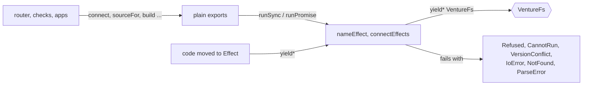

# Knowledge connectors

The knowledge layer is where every record is stored and found. It does not copy records into one place. Each venture keeps its records wherever it already works, and Mentura reaches each source through a connector (EE-037).

## The parts

| Part | File | What it does |
|---|---|---|
| Contract | `contract.ts` | The five things every connector does: `list`, `read`, `version`, `search`, `write`. A version is the git blob SHA-1 of the content in every source. `write` compares versions when asked (see below). |
| Registry | `../tooling/integrations.json`, `index.mjs` | An integration with a `connector` names the module that implements the contract for it. An app that hosts Naive adds its own connectors at run time with `registerConnector(id, { module, writes, options })` in `index.mjs`, naming its module by absolute path; a registered id replaces the framework's entry of the same id. |
| Source map | `<venture>/knowledge/sources.json` | Optional. The venture's sources, and which record type lives in which. Unnamed record types stay in the venture folder. Schema: `packages/naive/src/records/knowledge-sources.schema.json`; checked by `packages/naive/src/checks/check-sources.ts`. |
| Connectors | `filesystem.ts` | A folder or git repository (writes in place). Naive ships only this one: it works offline and names no vendor. It maps a logical path to where the venture's layout keeps it, in any layout other than flat (structured, or src, where a package folder sits under its function). Connectors that reach a vendor, such as GitHub, belong to the app that hosts Naive (Mentura), which registers them (EE-041). Hosted, the last commit a read reports comes from the host's git working copy, and a read has no `commit` without one. |
| Matrix | `resolve.ts` | The source-of-truth matrix (EE-042): `rules` in the source map name a system of record and owner per record type, attribute and context (phase, product, account, actor). The most specific rule wins; a tie is an error. `records` is shorthand for rules that match anything. An attribute rule (a price in another source) is read from and written to that source, so the record's own file holds no second copy. |
| Where-used | `<venture>/knowledge/where-used.json` | For each fact kept once (a price, a product name), every place that repeats it, live or frozen. `packages/naive/src/checks/check-where-used.ts` reports drift offline; delivering the change into vendors is the platform's. |
| Catalog | `catalog.ts` | One index over every source: address, version, route, title and words. No content. Routes `knowledge/catalog` and `knowledge/search`. |
| Evals | `suite.ts`, `eval.ts` | `suite.ts` is the contract suite every connector passes, Naive's or an app's. `eval.ts` runs it on the filesystem connector and checks that an app's connector registers and connects. The evals that run routes (the router over a mapped folder, the catalog, the source-of-truth matrix and attributes) are [`packages/naive/src/interfaces/tests/connectors-router-test.ts`](../../interfaces/tests/connectors-router-test.ts), because they import the router. An app runs the suite on its own connectors. |

## Written in Effect

The connectors are written as Effects (EE-125): they reach files through `VentureFs` and fail with Naive's tagged errors (`packages/naive/src/core/effect/errors.ts`). The plain exports keep their old names and shapes, so the router, the checks and an app's `registerConnector` calls do not change. The naming is fixed once:

- Every exported function `name` that reads files or can fail has an Effect version `nameEffect` with the same arguments, which succeeds with what `name` returns or resolves to: `sourcesOfEffect`, `sourceForEffect`, `attributeSourcesEffect`, `registryEffect`, `registerConnectorEffect`, `connectEffect` and `connectAllEffect` in `index.mjs`; `safePathEffect` and `checkWriteEffect` in `contract.ts`; `loadEffect`, `buildEffect` and `searchLiveEffect` in `catalog.ts`. `name` runs it with `runSync` or `runPromise`.
- A connector's own methods are the one exception, because the contract is an object: `connectEffects(options)` in `filesystem.ts` gives the filesystem connector whose five methods return Effects, and `connect(options)` gives the same connector with each method run as a Promise.
- Pure functions stay plain: `resolve.ts` whole, `search`, `blobSha`, `address`, `words`, `matches`, `isText` and `conformance`.



The errors a plain export throws are the tagged errors themselves, each an `Error` with the message it had before: a path outside the source, a read-only source, a held lock and a bad append are `Refused`; an unknown connector, a module that breaks the contract and a source map whose rules tie or name a missing source are `CannotRun`; a stale base is `VersionConflict`, which keeps `code` (`version-conflict`), `current` and its `(path, base, current)` constructor, so an app's connector builds it as before. A connector the registry names is still the contract's object with Promise methods, whichever module made it, so `connectEffect` gives that object and code calling its methods wraps them with `Effect.tryPromise`.

## A source map

```json
{
  "sources": [
    { "id": "team-repo", "connector": "github", "repo": "acme/tandem", "ref": "main", "root": "ventures/tandem" }
  ],
  "records": { "product": "team-repo" }
}
```

The `github` connector is the app's: Mentura registers it, and Naive alone has no `github` connector, so `node packages/naive/src/checks/check-sources.ts` refuses this map in a copy of Naive without the app. With this map, `purpose/product/kettle` reads `ventures/tandem/products/kettle.json` from `acme/tandem` and says which version and commit it came from. A write opens a draft pull request, which a person accepts by merging. Every other record stays in the venture folder. The venture folder always keeps `venture.json`, the provenance log and drafts.

## Compare on write

Two writers can start from the same copy of an item, such as two hosted requests for one tenant. `write(path, content, opts)` takes two options so the second one is refused instead of overwriting the first:

- `base`: the version the writer started from, or `null` for an item it believes is new. When the item's current version differs, the write is refused with a `VersionConflict` (`code` is `version-conflict`) whose `current` is the version now, or `null` when the item is missing. The item is left as it was. Retrying is the caller's business.
- `append`: `content` is new lines (ending in a newline) added to the end of a log. With `base`, the append is refused unless the stored log is still exactly the copy the writer began from, so a hash chain such as `provenance.jsonl` stays whole. An append that is not whole lines, or onto a log that ends mid-line, is refused.

A write without either option replaces the item, as it always has. `checkWrite` in `contract.ts` holds the rules, so every connector refuses the same writes. The filesystem connector reads a file once, so a read's version is the hash of exactly the content it returns even while another process appends. It holds a lock file beside the item (`.<name>.lock`, never listed) while it compares and writes, and removes a lock older than 30 seconds as one left by a process that died. The contract suite checks both options on every connector that writes direct, so an app's database connector proves the same behavior.

## Adding a connector

1. Decide which side it is on. If it works offline, needs no credentials and names no vendor, it is Naive's and goes in `packages/naive/src/store/connectors/<id>.ts`. Otherwise it is the app's: it lives in the app, which calls `registerConnector` (EE-041). `node packages/naive/src/checks/check-boundary.ts` enforces this: a connector in the registry must be in this repository, offline and without credentials, and no code names an app's module.
2. Export `connect(options)`, returning an object that meets the contract.
3. For a Naive connector, add a `connector` to its entry in `packages/naive/src/records/layers/knowledge/tooling/integrations.json`: the module, its write modes and its options. An app passes the same fields to `registerConnector`.
4. Run it through `contract()` from `suite.ts`: against a fake of its API offline, and against the real one when credentials are given.

## Running the evals

```sh
node packages/naive/src/store/connectors/eval.ts                 # the contract, and an app's connector registered
node packages/naive/src/interfaces/tests/connectors-router-test.ts    # through the router
node packages/naive/src/store/connectors/effects-test.ts               # the Effect versions on an in-memory VentureFs
node packages/naive/src/store/connectors/service-test.ts               # Connectors as a service
```

## Connectors as a service

`service.ts` names how a venture reaches its sources as one Effect service, `Connectors` (EE-161, phase 7): `connect(source, dir)`, `connectAll(dir)` and `sourceFor(dir, recordType, context)`, and `connectorFor(dir, recordType)` for the source and connector that hold a record type. It is a `Context.Reference` whose default is the `registerConnector` registry above, so an Effect that asks for it needs no layer; a host that keeps records in Postgres or Neon provides another with `Layer.succeed(Connectors, ...)`. Its methods run over the `VentureFs` in scope. The plain `connect`, `connectAll` and `sourceFor` keep working; the router does not ask for the service yet (not built; phase 8).
