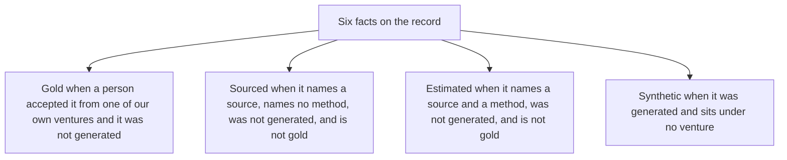
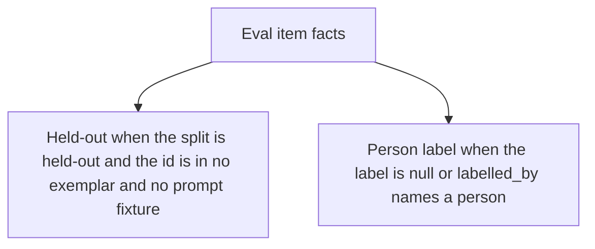

# terms

Up: [src](../README.md)

## What this is

The EE-095 term engine: every term is admitted through one pipeline with a valid test, cross-runs and the Lean theorems it names. Also the ontology (the canonical nouns), the catalog of ontologies, the catalog of outside standards and Naive's operating rules. Nothing symbolic bypasses it (`bypass-guard-test.ts`).

## Where things are

| Path | Holds |
|---|---|
| [`admit.ts`](./admit.ts) | Admit every term through the same pipeline (Torian, 2026-10-31. |
| [`admitted.json`](./admitted.json) | The admitted terms, written by `admit.ts`. |
| [`bypass-guard-test.ts`](./bypass-guard-test.ts) | Fails the suite when a symbolic check bypasses the EE-095 term engine and the Lean proofs. Plain checks, such as `check-traces.ts` (hash chains and links) and `check-write-scope.ts` (path prefixes) and `check-detectors.ts` (ledger chains, references and arithmetic) `check-signals.ts` (schema shape, field owners and reducers, content hashes, paths and references) and `check-recipes.ts` (chains, references, budget counts and renders compared again), are registered with a reason. |
| [`catalog-test.ts`](./catalog-test.ts) | Checks the catalog of ontologies (N-050). |
| [`engine-test.ts`](./engine-test.ts) | Tests the term engine, including the cross-run that confirms the four data labels are pairwise disjoint. |
| [`evals.ts`](./evals.ts) | Builds the facts for one eval item and runs held-out-item and person-label (EE-198). |
| [`evals-test.ts`](./evals-test.ts) | A held-out id in an exemplar does not pass, and a label an agent set does not pass. A null label passes, and so does a person's label. |
| [`engine.ts`](./engine.ts) | The term engine (EE-095; Torian, 2026-10-31). |
| [`fixtures/`](./fixtures) | Fixtures for the membership gate's tests. |
| [`fixtures.ts`](./fixtures.ts) | Real arrangements, run beside the generated cases. |
| [`gen-concepts-test.ts`](./gen-concepts-test.ts) | Regenerates the Lean ontology concepts from small fixtures and checks what packages/naive/src/terms/gen-concepts.ts does. Its arrays carry explicit types, so the type check of the whole repository does not depend on the order tsc reads files in. |
| [`gen-concepts.ts`](./gen-concepts.ts) | Writes one Lean `Concept` per noun in packages/naive/src/terms/ontology.json to packages/naive/lean/Naive/Generated/Ontology.lean. |
| [`labels.ts`](./labels.ts) | Judges one record's facts as sourced, estimated, synthetic or gold (EE-191). |
| [`labels-test.ts`](./labels-test.ts) | A generated record under a venture passes no label, an accepted record from an observed venture is not gold, and a record with a source and a method is estimated. |
| [`lean-agreement.ts`](./lean-agreement.ts) | Reads the Lean proofs and the admitted terms and lists where they disagree (`disagreements`, `readLean`). It ships in the package, so an app such as Mentura's reconcile runner imports it. |
| [`lean-agreement-test.ts`](./lean-agreement-test.ts) | Runs `lean-agreement.ts` as a test: fails the suite when the term engine and the Lean proofs disagree about which terms and theorems exist. |
| [`levels.ts`](./levels.ts) | The levels terms are defined at, each with its facts and a seeded case generator. The detector and trial levels hold the signal detection terms. The reception level (one signal arriving at one listener) holds the signal library terms; its signals and listeners come from pools, so one signal reaches many listeners. The experiment, plan and settlement levels hold the autoresearch terms. The data level holds sourced, estimated, synthetic, gold, held-out-item and person-label. `dataCases` draws the six label flags and the eval flags on their own, so each property passes and fails. The source level holds allowed-source. `sourceCases` draws hostDenied and loggedOff on their own. |
| [`ontology-catalog.json`](./ontology-catalog.json) | The catalog of ontologies, one scope per function (N-050). |
| [`standards/`](./standards/README.md) | The catalog of outside standards, one record per standard: status, users and gaps (EE-150). |
| [`standards-test.ts`](./standards-test.ts) | Checks the catalog of standards: ids, the nouns and record types named, and status (EE-150). |
| [`ontology-gate-test.ts`](./ontology-gate-test.ts) | Behavior of the membership gate. |
| [`ontology-gate.ts`](./ontology-gate.ts) | The membership gate (the first gate of the handoff pipeline). |
| [`ontology-metamodel-test.ts`](./ontology-metamodel-test.ts) | Behavior of the ontology metamodel (N-048). |
| [`ontology.json`](./ontology.json) | The canonical nouns (EE-014). The lead agents design proposes `handoff claim` (a kind of process), `capability cluster` and `connection` (function it), `spend register` (function finance), `access matrix`, `seam` (a seam detector compares two functions' records), and `lead`, `portfolio` and `lead plan`, all status proposed. |
| [`ontology.md`](./ontology.md) | The readable form of `ontology.json`. |
| [`operating-rules-test.ts`](./operating-rules-test.ts) | The operating-rules module, including the chief of staff's role in the role library (`packages/naive/src/roles/chief-of-staff/role.json`). |
| [`operating-rules.json`](./operating-rules.json) | Naive's default operating rules, which a venture can override. |
| [`operating-rules.ts`](./operating-rules.ts) | Naive's operating rules, as a module a venture can override. |
| [`sources.ts`](./sources.ts) | Builds the facts for one source write and runs allowed-source (EE-192). A denied host or a logged-in fetch is refused here, and nowhere else. |
| [`relations.ts`](./relations.ts) | The typed relations an idea record may state (S2-PR9). Every relation name is kebab-case (`builds-on`, `appends-to`, `derives-from`); `packages/naive/src/engine/rename-relations.ts` renames the old snake_case values in existing idea records. |
| [`terms.ts`](./terms.ts) | The admitted and proposed terms. The signal detection terms (detector, trial, hit, miss, false-alarm, correct-rejection) cite the theorems in [`Detection.lean`](../../lean/Naive/Detection.lean). The signal library terms (signal, listener, reception, salient-reception, noise) cite the theorems in [`Signals.lean`](../../lean/Naive/Signals.lean). Signal reads only a signal's facts and listener only a listener's; salient reception and noise read the pair, and `engine-test.ts` shows that no property of a signal alone defines noise: some generated signals are noise at one reception and salient at another. The autoresearch terms (experiment, kept-experiment, discarded-experiment, eval-plan, settled-record) cite the theorems in [`Recipes.lean`](../../lean/Naive/Recipes.lean); settled-record reads no agent claim, and `engine-test.ts` shows that adding agent claims changes no verdict. The data labels (sourced-record, estimated-record, synthetic-record, gold-record) cite the theorems in [`Labels.lean`](../../lean/Naive/Labels.lean). Gold needs a person's acceptance and one of our own ventures. A synthetic record sits under no venture. No property reads the declared label. The term allowed-source cites `denied_host_never_allowed` in [`Sources.lean`](../../lean/Naive/Sources.lean). The eval terms held-out-item and person-label cite `held_out_disjoint_exemplar` and `agent_label_never_passes` in [`Evals.lean`](../../lean/Naive/Evals.lean). person-label states that a label is non-null only when a person set it, because the faithful-author term is not on main. |
| [`upper-test.ts`](./upper-test.ts) | Checks the upper ontology (N-049) through the EE-095 term engine. |

## Data labels

`judgeLabel` in [`labels.ts`](./labels.ts) runs the four terms. It returns the one label that passes, none when none pass, or illegal when more than one passes. The Lean theorems say the last case does not occur.

`pcf-citation` (EE-199) judges one APQC citation. It passes when the element id is in `pcf.json`, the cited name is that element's name, and the cited version is that file's version. [`../checks/check-citations.ts`](../checks/check-citations.ts) runs it on every `departments.json` category and every ontology standard that names APQC PCF. The theorem `citation_needs_element` says an unknown element id does not pass. `check-pcf.ts` and `check-tools.ts` still compare ids as plain checks. EE-199 records that as debt.

## Eval items

`judgeHeldOut` and `judgePersonLabel` in [`evals.ts`](./evals.ts) run the two terms. A label an agent set fails person-label. An id that appears in an exemplar fails held-out-item.

## Run and test

- `node packages/naive/src/terms/admit.ts` regenerates the admitted terms.
- `node packages/naive/src/terms/engine-test.ts` tests the engine.
- `node packages/naive/src/terms/labels-test.ts` tests the data labels.
- `node packages/naive/src/terms/evals-test.ts` tests held-out-item and person-label.

The operating-rules loader and the ontology gate check a module or a handoff against its schema with `validateFile` from [`packages/naive/src/records/validate.ts`](../records/README.md). A checker that cannot run is still a tool error, never a verdict; the tests prove it with a validator that has no schemas (`useValidator`).

`bypass-guard-test.ts` registers `check-functions.ts` and its test as plain checks: they compare ids and apply a fixed rule (one-way doors and never-redelegated classes are escalate), so nothing symbolic needs the engine. It registers `check-phases.ts` and its test as plain checks for the same reason: they compare ids and add up weights. It registers `check-tools.ts` (the tool catalog, EE-163) and its test as plain checks too: they compare ids, APQC number prefixes and record type names. It registers `check-activities.ts` (the activity catalog, EE-164) and its test as plain checks: they compare ids, count words and sentences, and hold ratings to the ranges the catalog's scales give. It registers `check-pcf.ts` (APQC's PCF as data, EE-165) and its test as plain checks: they compare hierarchy ids, levels, names and element ids, and count categories. It registers `check-pcf-coverage.ts` (coverage of the PCF by the function modules, EE-226) and its test as plain checks: they match ids and id prefixes and count what matched, with the same debt. EE-199 records that comparison, and the same comparison in `check-tools.ts`, as debt. `check-citations.ts` is the symbolic check. It reaches the engine.

`bypass-guard-test.ts` registers `packages/naive/src/checks/check-records.ts` and its test as plain checks: they pick a record type by a file's logical path and validate it against its JSON Schema, so no term is decided.

It registers `engine/gate-service.ts` as plain too: the gate as an Effect service, whose default runs `gate.ts`'s route rules, pins and role access, so it decides no term.

`bypass-guard-test.ts` registers `packages/naive/src/engine/phase-gate.ts` (gate strength, EE-156) and its test as plain checks: they grade evidence by GRADE arithmetic, count interviews and compare levels with a policy's minimums, so no term is decided. It registers `packages/naive/src/engine/gate-calibration.ts` (EE-157) and its test as plain checks for the same reason: they compare anatomy cell values with listed values and numeric thresholds and raise levels by rule.

`bypass-guard-test.ts` registers `packages/naive/src/checks/check-owners.ts` and its test as plain checks: they resolve each element's owner by a fixed precedence and compare role ids, so no term is decided.

`bypass-guard-test.ts` registers `packages/naive/src/checks/check-language-rubric.ts` and its test as plain checks: they check the rubric's shape, that weights sum to 1 and that every source is a reference id, so no term is decided.

`bypass-guard-test.ts` registers `packages/naive/src/checks/check-canary.ts` as a plain check: an eval file's canary is equal to one fixed string. It registers `packages/naive/src/checks/check-evals.ts` as symbolic, because that check runs held-out-item, person-label, synthetic-record and allowed-source. The test beside it is plain.

`bypass-guard-test.ts` registers `packages/naive/src/checks/check-bets.ts` (bets, EE-221) as a plain check: it compares bet ids, frozen fields with the stored version and registered lines as intervals, so no term is decided.

`bypass-guard-test.ts` registers `packages/naive/src/checks/check-pre-registration.ts` (pre-registration, EE-220) and its test as plain checks: they compare a registered record's frozen fields with the stored version, so no term is decided.

`bypass-guard-test.ts` registers `packages/naive/src/checks/check-problems.ts` (the problem hierarchy, EE-219) and its test as plain checks: they resolve parent and cause ids and count targets, so no term is decided.

`bypass-guard-test.ts` registers `packages/naive/src/checks/check-documents.ts` (the document catalog, EE-218) and its test as plain checks: they resolve catalog ids and read whether a person approved the rung below, so no term is decided.

`bypass-guard-test.ts` registers `packages/naive/src/checks/check-visibility-rubric.ts` (the visibility rubric, EE-222) and its test as plain checks: they check the rubric's shape and that its weights sum to 1, so no term is decided.

`bypass-guard-test.ts` registers `packages/naive/src/checks/check-goals.ts` (the goal ledger, EE-210) and its test as plain checks: they compare goal ids, parents and statuses, so no term is decided.

`bypass-guard-test.ts` registers `packages/naive/src/checks/check-runs.ts` (proof of work, EE-227) as a plain check: it compares provenance line hashes, sessions, roles, times and routes with a run's package, so no term is decided.

`bypass-guard-test.ts` registers `packages/naive/src/checks/check-roles.ts` (the role library, EE-229) and its test as plain checks: they validate each role file against its schema, resolve verifier ids and aliases, and compare a person role's declared tier with one fixed value, so no term is decided.

`bypass-guard-test.ts` registers `packages/naive/src/checks/check-direct-writes.ts` and its test as plain checks: they count write calls by name and compare them with a list, and decide nothing about what a thing is.
