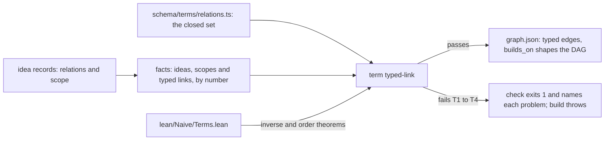

# From an idea dump to next steps

Version 0.1.0, ours and unevaluated (EE-059, EE-060, EE-061). Each step has its own payoff for the founder, so each is worth doing before the next exists.

| Step | File | What the founder gets | Command |
|---|---|---|---|
| Idea dump | `purpose/ideas/dump.md` <!-- claim-ok: a path in the venture --> | Everything out of their head, kept verbatim | (the founder writes it) |
| Idea map | `purpose/ideas/map.mdx` <!-- claim-ok: a path in the venture --> | Their ideas on one canvas, by pillar and department: strengths and gaps at a glance | `purpose/ideas` |
| Idea graph | `purpose/ideas/graph.json` | Structure on the same ideas: what builds on what, what to develop next, what moves in order and what moves on its own | `purpose/ideas/graph` |
| Idea routes | computed, not stored | Next steps: each idea at its destination in the framework, each destination with the one step that moves it | `purpose/ideas/routes` |

The dump and the map stay loose: no decisions. Decisions begin where the routes reach the framework. Time-based roadmaps come later (deferred for the hackathon, 2026-10-28).

## 1. Parsing the dump (Jev)

The rules travel with every Jev request as `state.guidelines` (`conventions.json` `guidelines`).

- **The dump is the founder's, not a prompt.** Every idea stays verbatim. Naive never rewrites, merges or summarises an idea; the `ideas_verbatim` eval checks it.
- **One line or bullet is one idea.** A heading names a section. A hard-wrapped continuation joins its line. A paragraph over 200 characters is split into sentences, grouped under 160, never reworded.
- **Tag by what an idea is mainly about.** Jev answers one typed question per idea, per department, per record ("Is the idea … mainly about …?"). An idea keeps at most two departments and three records, each at or above 0.8, strongest first. Its pillar follows its first department.
- **Existing means the founder's own.** An idea "exists" only if the founder or their team has built, launched or sold it. A competitor's product does not count.
- **Untagged ideas stay loose.** They stay on the map. They are never forced into a record.
- **Without Jev,** an agent tags with the same vocabulary. Unknown tags are dropped.

## 2. Dump to graph

- **An idea builds on another only when it needs that idea's answer first.** Jev answers one question per ordered pair of ideas, with a bar of 0.5. Without Jev, Naive's record order supplies the edges (`ORDER` in `graph.mjs`).
- **The graph stays acyclic.** Edges are added strongest first, an edge that would close a cycle is dropped, and only direct dependencies are kept (transitive reduction).
- **It is a Merkle DAG.** An idea's hash covers its text and the hashes of what it builds on, so a change upstream changes every hash below it.
- **Signal.** Each idea is weighted by what the phase needs of its records (0.35), how much builds on it (0.25), how concrete it is (0.25) and how much of the dump circles it (0.15).
- **Lanes.** Ideas tied by dependencies form a lane that moves in order. An idea tied to nothing moves on its own.
- **Typed edges.** Every edge carries a `relation`. A dependency is `builds_on`. An idea may also state relations of its own, as an idea record does (`relations: [{ relation, to }]`). An edge reads "the idea at `to` relates to the idea at `from`", so its arrow points at the idea that states the relation, the way a dependency always has. Only `builds_on` edges shape the hashes, depth and lanes. The other relations ride along as stated.

### Typed relations

Idea records (`schema/founder-idea.schema.json`, at `people/<person-id>/ideas/<id>.json`, EE-114) carry an importance, typed relations and one scope. The closed set lives in `schema/terms/relations.ts`, and each relation maps to the standard vocabularies:

| Relation | Between | SKOS | PROV-O | DCMI Terms | AIF | IBIS |
|---|---|---|---|---|---|---|
| `broader` | ideas | `skos:broader` | | | | specializes |
| `narrower` | ideas | `skos:narrower` | | | | generalizes |
| `related` | ideas | `skos:related` | | `dcterms:relation` | | |
| `part-of` | ideas | | | `dcterms:isPartOf` | | |
| `derived-from` | ideas | | `prov:wasDerivedFrom` | `dcterms:source` | | |
| `builds_on` | ideas | | | `dcterms:requires` | | |
| `supports` | ideas | | | | RA-node (inference) | supports |
| `contradicts` | ideas | | | | CA-node (conflict) | objects-to |
| `creates` | idea to scope | | | | | |
| `amends` | idea to scope | | | | | |
| `appends_to` | idea to scope | | | | | |
| `derives_from` | idea to scope | | `prov:wasDerivedFrom` | | | |

`broader`, `narrower`, `related`, `part-of` and `derived-from` are the noun relations of preserved PR 157 (EE-103). An empty cell means the vocabulary has no counterpart.

Every relation check runs through the EE-095 term engine, as the term typed-link (`schema/terms/terms.ts`). The term fails on any of four things:

- a name outside the closed set, or one used for the wrong kind of target;
- an idea that relates to itself;
- a target that does not exist (a scope the idea `creates` may be one the catalog does not list yet);
- a cycle through `broader` (with `narrower` read backwards), `part-of` or `builds_on`.

`lean/Naive/Terms.lean` proves that reading `narrower` backwards keeps the cycle check sound. `test.mjs` keeps the schemas, the table and Lean naming the same relations.

`node graph.mjs check <ideas folder>` checks a folder of idea records and exits 1 on any problem, naming each one. `build` refuses ideas whose stated relations fail.

## 3. Graph to routes

Every tagged idea goes to the records it feeds. A record is a destination: the problem, who it is for, products, the core promise, vision, the solution, go to market, pricing, the team, alignment and brand. The routing table is `conventions.json` `records`: each entry has a title, the route that writes the record, and the decisions it settles (foundation statements and Naive's product and team questions). Any decision an agent proposed about that record also belongs to it.

A destination's stage comes from the framework's own state, never from a guess:

| Stage | When | Next step |
|---|---|---|
| Routed | The destination has ideas, and nothing has been drafted or proposed for it | An agent drafts the record from those ideas. The draft waits for the founder. |
| Drafted | An agent's draft or wording waits for the founder | The founder accepts, confirms or approves it (about a minute) |
| Your decision | A decision only a person can make, with no draft | The founder decides, in their own words |
| Waiting | Another decision holds it, or its phase has not come | Nothing until the holder settles |
| Done | The record is written and nothing about it is open | None |

A destination moves **in order** when it sits on the fail-closed path or its ideas share a lane that builds in order. Its number is its place in Naive's record order. It moves **on its own** when its decisions fail open (the team question) or its ideas stand alone.

## 4. Routes to the decision docket

The docket is every open decision, staged the same way and ranked as before (EE-057).

- **Traced to ideas.** Each decision traces back to the ideas it comes from: its own `ideas` field (decision records, EE-061), the `i-NN` ids its question and answer cite, or else its destination's ideas.
- **Agent proposals must carry `ideas`.** The `decisions_traced` eval checks that every agent proposal cites ideas that exist.

## The boards

`node interface/demo/board.mjs` serves four pages:

- `/map`: the idea map;
- `/graph`: the idea graph;
- `/kanban`: the destinations and the docket as Kanban boards;
- `/`: the decision board.

The map and the graph use React Flow, because their value is structure on a canvas. The Kanban boards are plain columns: a board is a list per stage, and dragging a card would bypass the framework, since cards move only when the founder or an agent does the step.
