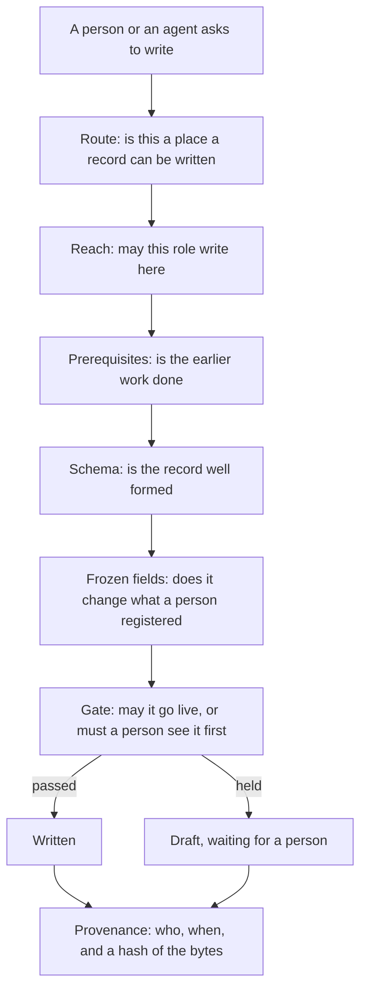

Naive keeps everything a business knows in one place, as files, and controls who may change them.

## A business is a folder of records

A record is one JSON file: a goal, a decision, a customer profile, a handoff. Each record type has a schema and one function that owns it. There are 13 functions, the same 13 categories as the APQC process framework.

## Every change goes down one path

A write is refused or held at the first step it fails.

## People decide. Agents draft.

An agent's write that settles something is held as a draft. A person accepts it, changes it or sends it back. One-way doors, such as spending money or publishing, are never delegated.

## The history is kept

Each write adds a line to a log, and each line carries the hash of the line before it. The bytes of every version are kept, so a record can be read as it was at an earlier time.

## The parts

Records and their schemas. The term engine, which judges whether a word is used as defined. The store, which reads and writes files. The engine, which holds the logic of phases, goals, decisions and freshness. The checks. The router. Three ways in: a command line, an MCP server and a local HTTP API.

## What is proven

The rules for element states, and several others, are modelled in Lean and proved there. The proofs are of the models. A test compares the models with the code on fixed cases.

## What Naive does not do

- It does not call a model. Agents run in your own tool, such as Claude Code or Cursor, and reach Naive through the three ways in.
- It does not verify identity. A role is declared by the environment, not signed.
- It does not deploy a site or send anything for you.
- It ships one store, the file system. A hosted store is the host's to provide.
- Reading a record as it was works only for versions written through the router.
