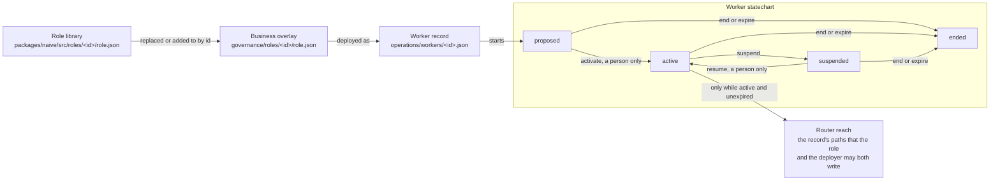

Use this page to understand what a role is in Naive, how its work is checked, and how an agent runs as a role only after a person allows it.

## A role is one record

{/* Source: packages/naive/src/records/role.schema.json, packages/naive/src/engine/agents/roles.ts, packages/naive/src/checks/check-roles.ts (EE-229) */}

A role is a job that a person or an agent holds, such as founder, architect or finance agent. Each role is a module in the role library at `packages/naive/src/roles/<id>/`: a `role.json` and a SKILL.md on how to act in it. Every role has an id, a name, a kind (`person`, `agent` or `either`) and a description. An agent role also names its function, skill and verifier. A person role, such as founder or board member, is never deployed as an agent.

A business's own roles at `governance/roles/<id>/role.json` replace a library role with the same id or add new ones. `node packages/naive/src/checks/check-roles.ts` checks every role file, and `naive check` runs it on a business.

## Naive's own roles

{/* Source: agents/README.md, naiveRoles in packages/naive/src/engine/agents/roles.ts (EE-238) */}

The roles that build Naive live under `agents/`: product manager, architect, requirements engineer, release manager, technical writer and instruction steward. They have a library role's shape, and a business never sees them. A role there may extend a library role and leave out what it inherits, as the product manager extends the product and design lead. The technical writer owns every page on this site. The instruction steward keeps instruction files true to the code, and never deletes one without a person.

## What a role makes

{/* Source: packages/naive/src/engine/artifact-kind.ts, packages/naive/src/functions/documents.json (EE-230, EE-238) */}

Each artifact a role lists is a record type in the data model or a document kind in the document catalog, `packages/naive/src/functions/documents.json`, and nothing else. The catalog's 13 kinds include a memo, a spec, an architecture decision record (`adr`) and a docs page. A kind names the brand fields that style it and may name its one maker: only the technical writer makes `docs-page`, `release-note` and `changelog-entry`. A harness adapter lists the artifacts its harness can produce.

## Artifact lint and the findings log

{/* Source: packages/naive/src/checks/artifact-lint.ts, packages/naive/src/engine/lint-findings.ts (EE-231) */}

`naive lint artifacts` checks each artifact a business holds against the type it declares. Protocol rules are always errors: the type exists, the format is allowed, the required sections are present, each section cites a record and field or shows a hole, and the ladder's order and approvals hold. Design rules, such as brand fields filled and length, warn by default. Set each one to `off`, `warn` or `error` under `artifact_lint.rules` in `naive.config.json`.

Every finding is appended to `.naive/lint-findings.jsonl`, and `naive lint report --by rule`, `--by role` or `--by harness` counts them, so you can see which rules fire before you tighten one.

## Role programs

{/* Source: packages/naive/src/checks/role-program.ts, packages/naive/src/checks/role-check.ts, packages/naive/src/roles/architect/role.ts (EE-237) */}

Every role has a program of deterministic checks of what it makes. The default program comes from its `role.json`: its artifacts are known types that pass the artifact lint, its reads exist, and its lint suites run. A library role can add checks in a `role.ts`, which run after the default ones and never replace them. The architect's program requires every architecture decision record to be built from a decision record the business has. Naive never loads a `role.ts` from a business folder, because agents write that folder.

`naive role check <role>` or `--all` runs the programs. Inside a business, findings go to the findings log and any error exits 1. Outside one, only the checks that need no business run.

## Links to the process framework and to O\*NET

{/* Source: packages/naive/src/checks/check-roles.ts, scripts/pcf-roles.ts, packages/naive/src/engine/onet-match.ts, packages/naive/src/functions/onet.json (EE-232) */}

A role names the elements of the APQC Process Classification Framework (PCF) it answers for, each with its RACI part: responsible, accountable, consulted or informed. At most one role is accountable for an element. `node scripts/pcf-roles.ts` writes the reverse map, and `--check` fails when it is stale. `check-roles.ts --complete` lists each element of levels 1 and 2 that no role is responsible or accountable for, and suggests O\*NET occupations by word overlap, as leads for a person and never as matches.

## Roles in the element graph

{/* Source: packages/naive/src/engine/element-graph.ts (EE-234) */}

`naive graph --role <id>` shows what a role depends on, what depends on it, its elements by RACI part and its artifacts. Dependencies are derived, never typed: role A depends on role B when A reads a record type B produces. A cycle is reported, never refused.

## Digital workers

{/* Source: packages/naive/src/engine/agents/workers.ts, packages/naive/src/engine/agents/worker-state.ts, packages/naive/src/engine/agents/reach.ts, packages/naive/lean/Naive/Workers.lean (EE-235) */}

A digital worker is one role deployed as an agent, recorded at `operations/workers/<id>.json` with its role, mode (temporary or durable), sponsor, the paths it may write, its expiry and its status, which follows the statechart in the diagram above. Only a person activates or resumes a worker, and an ended worker stays ended. A worker writes only while active and unexpired, and only paths its record names that its role and its deployer may both write. The router reads the worker record on every write and refuses anything else. A Lean model proves that only a person activates a worker and that its writes never widen.

`naive workers` lists live workers, and `count` and `history` count them and show every change. A lead may write a temporary role and deploy workers as it, and only a person makes such a role durable.

## Spawning a worker

{/* Source: packages/naive/src/engine/agents/run.ts (EE-213, EE-235) */}

`naive agent spawn <function>-agent --task "<text>"` deploys a temporary worker of a function agent, with reach no wider than the agent's and an expiry. A person's spawn is active at once, runs through `NAIVE_AGENT_CMD` and ends when that run returns. The agent's own spawn waits, proposed, until a person runs `naive workers activate <id> --by <person>`. A worker never spawns another.

## The staffing gate

{/* Source: packages/naive/src/engine/staffing.ts, packages/naive/src/engine/spec-gates.ts, packages/naive/src/phases/spec-gates.json (EE-236) */}

`naive staffing` asks five gates, 0A to 1B, of a business's own records: are the ideas written down, is the problem researched, is the vision stated with a thesis that can fail, is the scope committed, and is the version specified well enough to staff. Each answer cites its record and field. Two questions have no record type yet, so they show as not built and never block.

`naive staffing draft` is refused, naming every missing answer, until 1B is reached. Then the lead whose portfolio holds human capital files one decision, "Would you like to begin deploying agents?", whose candidates are teams of proposed workers. A person decides, and `naive staffing apply --by <person>` activates the chosen team and ends the rest. An agent cannot apply.

## What is not built

- Running Naive's own roles as workers, and a staffing gate for Naive.
- `naive role check` and `naive graph --role` for Naive's own roles, which read the library only.
- Record types for a research synthesis and a business's own data model.
- A temporary worker in a staffing plan.
- A worker record for every running agent. `naive agent run` and `naive loop` start an agent without one.
