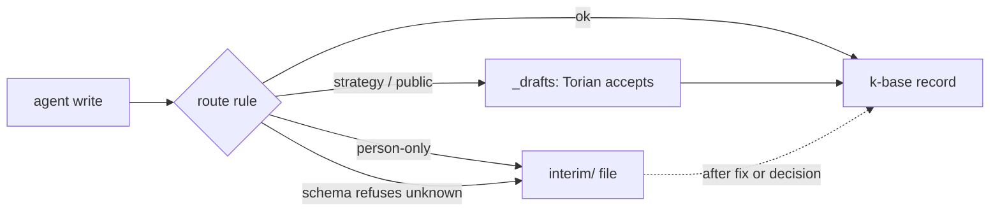

# GAPS.md: where Naive could not hold its own venture

Naive at `134d2d35063b8b232389b0fb254d152ae40639a1`. Every command ran through `tools/nv.sh` (agent actor `chief-of-staff` unless noted); the log is in `runs/naive-self-20261126-1/commands.jsonl` and `writes.jsonl`. Naive's code was not changed.

| # | Command | Result | Interim choice |
|---|---|---|---|
| G-01 | `naive new naive --yes ...` (no `--name`) | Scaffold writes 2 provenance lines as `kind: person, id: founder` though `MENTURA_ACTOR=agent` | Kept. Did not pass `--name "Torian CJ"`, which records Torian as the writer. Logged, not fixed |
| G-02 | `naive new --name "Torian CJ"` (attempt 1) | Provenance `person / torian-cj` for an agent run | Discarded attempt 1 (`evidence/commands-attempt1.jsonl`) |
| G-03 | `naive new --yes` | Sets purpose, operations, evidence, governance and interface layers to false | Re-ran with `--layers purpose,knowledge,operations,evidence,governance,interface` |
| G-04 | `venture.json` after `naive new` | No `mode` field; EE-188 says new ventures get `run` | None. Mode left absent |
| G-05 | `venture.json` functions | 9 legacy keys (foundation, validation, product...), not the 13 APQC functions | Counts in `record-counts.json` map routes to the 13 functions |
| G-06 | `raw/sources write` with a source only | `write needs { source, text }` | `tools/fetch_sources.py` fetches each page and writes source plus text (EE-192). SBA returned 403 and the usenaive.ai archive timed out; both kept with that status |
| G-07 | `foundation/core write` | `only a person writes foundation/core` (no draft path for agents) | `interim/foundation/core.json`, same fields |
| G-08 | `foundation/telos write` with `owner_outcome.path: null` | Enum has no unknown value | `interim/foundation/telos.json` keeps null; decision `owner-outcome` asks Torian |
| G-09 | `product/<id> write` | Locked until `product-exists` is decided; that decision is person-only | `interim/product/*.json` |
| G-10 | product `features[]` | No status or evidence field, so shipped/partial/planned can't be recorded | `interim/capabilities.json` (status, evidence, note per capability) |
| G-11 | `legal/risks/<id> write` as chief-of-staff | Only the risk-and-compliance agent may write | Retried as `risk-and-compliance-agent` (allowed by Naive's own writer rule) |
| G-12 | `legal/risks/<id> write` with unknown likelihood/impact | `impact: null is not of type 'object'` | `interim/legal/risks/*.json` keeps null. No numbers invented |
| G-13 | `service-delivery/offers write` as chief-of-staff | Function-agent only | Retried as `service-delivery-agent`; written |
| G-14 | Unit economics in discovery | No discovery route for cost per user; `finance/budget` needs beachhead | `interim/cost-model.json`, labelled estimate |
| G-15 | `operations/marketing/sitemap run` | Runs. `offerings: []` (product cards locked). `hiring: false` though `people/team-plan` has open roles: `presence.ts` reads only legacy `purpose/icp.json`. `--hiring` flag not parsed by the CLI. Mission, hiring, raising and contribute sections omitted | Plan saved as `marketing/sitemap` (agent write; a person confirms). `gen_site.py` adds about, vision and careers pages from records |
| G-16 | `operations/marketing/site run` | Needs `site-presence.json`, made by `harness/site.ts <url>` reading a live site | Not run: there is no Naive site URL to read yet |
| G-17 | `marketing/content write` with MDX | CLI parses input as JSON; route is beachhead-only | `tools/gen_site.py` emits `site-content/*.md` |
| G-18 | `system/phase-gate run` | Counts zero ICPs: drafts don't count, and foundation writes from agents are always drafts | Expected under "agents propose". Gate passes only after Torian accepts drafts |
| G-19 | Validation plan `by` | Requires a date; no unknown | `2026-12-31` placeholder on all 16 hypotheses. The schema had no field to mark it as a placeholder, so it is marked here only |
| G-20 | Pricing `model` | No `hybrid` value | `validation/pricing` keeps today's `freemium`; hybrid lives in decision `pricing-model` |
| G-21 | `node test.ts` | 3 failing groups: `naive port`, founders before ventures, decision affects grammar | None. Recorded in `interim/capabilities.json` |
| G-22 | `purpose/account/datafeel write` | `account.schema.json` has no fields for what an account does, customers, stage, HQ or size (no extra properties allowed) | Facts in the record's `note` with raw-source ids; structured fields with nulls in `interim/accounts/datafeel/profile.json` |
| G-23 | Replace `accounts/datafield` | The CLI has no delete verb for records | Re-wrote it via CLI as `status: closed`, `closed: 2026-11-26`, note "superseded by datafeel" (run naive-self-20261126-2) |
| G-24 | `raw/sources write` for datafeel.io | `raw/sources/datafeel-home already holds this text` (datafeel.io redirects to datafeel.com) | Kept the dedupe; the redirect is noted in the profile |
| G-25 | `decisions/datafeel-role write` for a choice Torian stated in chat (t27u) | An agent can only write `proposed` + `drafted_by`; `decided_by`/`provenance.approved_by` must come from a person, and `conversation[]` expects a `raw/sources/conversations-<date>` capture. There is no way to record "a person decided, relayed by an agent" | Wrote the decision as open with `proposed.answer` = customer, citing t27u in `reasons` and `conversation` (pointing at the run's prompt.md with its sha256). The account's `relationship` is set to `customer` now, since that field is not person-gated. Torian confirms the decision to close it |
| G-26 | Committing the venture to git with third-party page text omitted | `naive check` data-packages fails: `missing text.md` for each raw source | Text omitted from the repo copy (licence and republishing risk); URL and sha256 kept; re-fetch to restore |

