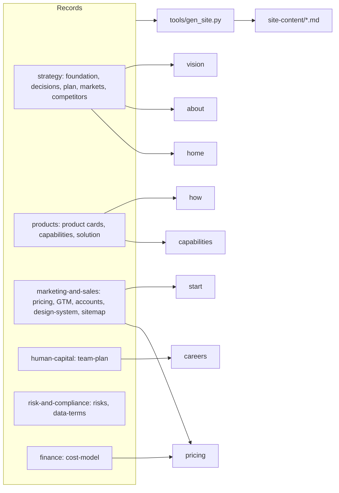

# ventures/naive: venture:naive built in Naive

This folder holds the dogfood run for venture:naive, built as real Naive records from Naive `134d2d3` (tchjhnsn/Naive main) through the CLI as an agent. There is no `phase --override` and no `--as person`. Every decision is still open for Torian.

The live records sit at the paths `data-model.json` claims, under `instance/` at the repository root. This folder keeps the run logs, the inputs those runs proposed, the interim copies Naive refused, and the generated site pages. `check-data-model.ts` ignores `ventures/naive/**/*.json` because those files are not live records.

| Path | What it is |
|---|---|
| `instance/workspace.json` | The workspace record (the file create-venture named `naive-workspace.json`; the data model claims `instance/workspace.json`) |
| `instance/naive/` | The venture's records on the flat layout, at the logical paths the data model names (raw sources, validation, decisions, accounts, competitors, markets, team plan, offer, sitemap). The run wrote a structured venture. The committed copy is flat so each file is that logical path |
| `instance/naive/_drafts/` | 12 strategy and public-commitment records Naive held as drafts for Torian (problem, 4 ICPs, 4 goals, constraints, discovery exit criteria, design system) |
| `instance/meta/workspace-init.jsonl` | The workspace init line. It is not a venture provenance record, so it is not named `provenance.jsonl` (that name under `instance/` is the venture log, at `instance/naive/provenance.jsonl`) |
| `interim/` | 13 records Naive refused (core, telos, 3 products, 6 risks), plus `capabilities.json` and `cost-model.json`. See GAPS.md |
| `STRATEGY.md` | Readable form of the records |
| `GAPS.md` | 26 gaps: command, result, interim choice |
| `WEBSITE-CONTENT-SPEC.md` | Per-page content spec and the record that backs each page |
| `site-content/` | Generated page Markdown (8 pages plus Naive's own sitemap plan) |
| `tools/` | `nv.sh` (env + log wrapper), `build_inputs.py`, `fetch_sources.py`, `write_records.py`, `gen_site.py`, `count_records.py` |
| `runs/naive-self-20261126-1/`, `runs/naive-self-20261126-2/` (Datafeel correction), `runs/naive-self-20261126-3/` (Datafeel role) | `run.json`, `prompt.md` (sha256 in run.json), `commands.jsonl`, `writes.jsonl`, `record-counts.json`, `evidence/` |

Regenerate the site content from the repository root's `ventures/naive`:
```
python3 tools/gen_site.py
```



## In this repo

- The run was made on the box at `/workspace/naive-self/`. Absolute paths in the run logs, and in `tools/nv.sh`, `tools/write_records.py` and `tools/build_inputs.py`, refer to that location. `tools/gen_site.py` and `tools/count_records.py` read the records committed under `instance/`.
- **Fetched page text is not committed.** Every `raw/sources/*/text.md` and `runs/*/sources/` is left out, and `runs/*/inputs/source-*.json` keep `text: null`. These pages are third-party, so only the URL, fetch time, HTTP status and sha256 are kept. As a result, `naive check --venture naive` in this copy fails `data-packages` with "missing text.md" (GAPS.md G-26). Re-fetch with `tools/fetch_sources.py` to restore the text locally.
- `.naive/` blobs and editor folders are left out.
- `tools/nv.sh` runs the CLI from this repo's checkout. Set `NAIVE_CLI` to override.
- The site pages stay here, not in `site/content/marketing/`. Every page is `status: not-publishable` until Torian accepts the drafts and decisions. Adding them to `site/content/marketing/meta.json` would publish them. To wire them in later: copy each accepted page to `site/content/marketing/<page>.mdx`, add it to `meta.json`, and run the site's publish gate (`site/gate`).
