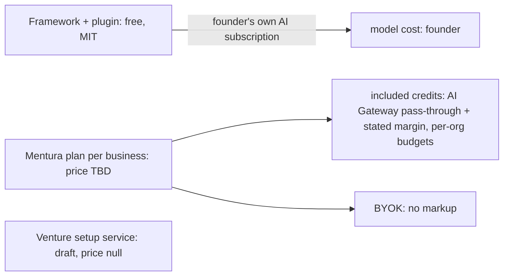
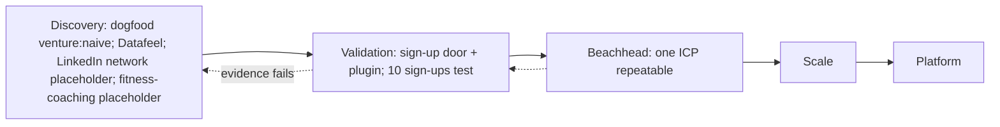

# venture:naive strategy: readable form

This is the readable form of the records. Records win if they differ. Everything here is **proposed by an agent; Torian decides**. "Naive" is the working name, and no naming decision is made here. Naive SHA: `134d2d3`.

## Ethos, mission, vision
- Ethos (Torian's words, `site/content/marketing/about.mdx` in tchjhnsn/Naive): **"If you have an idea, you are a founder."** It is quoted, not replaced. Record: `interim/foundation/core.json` (G-07).
- Mission: "Naive helps solo founders and small teams navigate the venture development lifecycle." (same file)
- Vision (PROPOSED, paraphrasing t23u): the default platform where small businesses choose to operate and scale. Record: `interim/foundation/telos.json`. The owner outcome is null (decision `owner-outcome`).

## Market position
Records: `markets/*`, `industries/software-publishers`, `competitors/*`, `foundation/icp/*` (drafts).
- Market: 36.2M US small businesses, 99.9% of firms (SBA, raw/sources/sba-faq-2026; it returned 403 to the fetch, so the figure comes from the earlier read). Non-employer filings in AI-exposed industries rose 26.8% from Q1 2024 to Q1 2026 (raw/sources/cnbc-solo-2026).
- Position: people decide and agents propose, against competitors that sell autonomy (usenaive.ai, polsia.com).
- Primary ICP (proposed): an AI-native solo founder already in Claude Code or Cursor.

## Top premise attacks
1. **Term engine needed?** Against: few buyers ask for it, and EE-095 admission checks only that a theorem name exists. For: it is the only guard against definition drift across agent writes. **Recommendation:** keep it (EE-095 and Lean stay firm), market the outcome ("every definition is checked"), and settle it with `h-term-engine-needed` and `h-term-engine-marketed`. Decision `term-engine-position`.
2. **Proof needs a working sign-up.** Mentura account creation exists, but hosted agent runs are not built. Decision `signup-door`; first hire is the founding engineer.
3. **Name clash.** usenaive.ai ("naïve, Inc", $28.5M raise per TechCrunch) publishes a CLI on npm, and naive.dev also exists. Risk `name-clash-usenaive`: flagged, not decided.
4. **Autonomy vs "people decide".** Competitors promise "never hire again"-style autonomy. Test with `h-solo-ai-founder`.
5. **Data line.** Selling small-business data looks like data brokering (datafield.co licenses SMB data to AI labs, self-reported). Terms are needed before the first paying customer. Decision `data-terms`, risk `data-broker`.
Also: scale ambition conflicts with an earlier "no scale target" record (decision `scale-ambition`), and the phase gate tests one premise at a time (`h-phase-per-premise`).

## Offerings and pricing (recommended, not decided)

- Evidence: hybrid pricing went from 1% to 20% of 71 AI apps (host0); usenaive.ai charges $20/$200 a month returned as credits; the reflect AGENT_RUNTIME Q10 design recommends pass-through first.
- Inference (ESTIMATE, `interim/cost-model.json`): $0.012–$0.18 per decision on input tokens. At an assumed 300 decisions a month, that is $3.6–$54 per active venture per month. Same-capability prices fall about 13x a year (Epoch).

## Go-to-market by phase

Accounts: `accounts/datafeel` (DataFeel, https://www.datafeel.com/, multi-energy haptics; target customer, prospect, per Torian t27u, decision `datafeel-role` awaiting confirmation; facts with sources in the record note and `interim/accounts/datafeel/profile.json`). `accounts/datafield` is closed as superseded (t26u). The other 2 accounts are placeholders with no names.

## Hiring (proposed order, `people/team-plan`)
1. Founding engineer, hosted agents: unlocks product proof.
2. Growth/GTM lead: unlocks the early-account tests.
3. Contract counsel: data terms and naming, before the first paying customer.
4. Design engineer and evals engineer (validation).
5. Formal methods (beachhead).

## Phases and evidence standard
- Naive's 5 phases (EE-012) follow Blank's customer development (https://steveblank.com/2009/09/17/), which loops back when evidence fails.
- Hypotheses use Strategyzer Test Cards (https://www.strategyzer.com/library/validate-your-ideas-with-the-test-card), with say < do evidence strength.
- 16 hypotheses are listed in `validation/plan`, all open with placeholder dates. The discovery gate has 8 items (`foundation/exit-criteria/discovery` draft).
