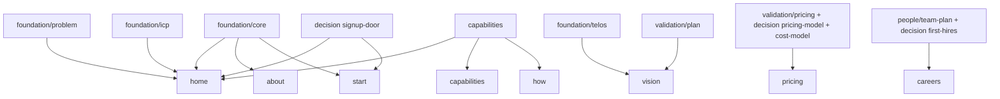

# Website content spec

Site content is generated from records: `python3 tools/gen_site.py`. This spec says what each page must show and which record backs it. It does not design the site.

Rules: show only what a record states. A null field prints `TBD by Torian`. A page is `not-publishable` while any source is a draft, proposed or interim. Show prices once they're decided (NN/g: https://www.nngroup.com/articles/show-price/). The home page says what it is, who it's for and the next step at a glance (NN/g: https://www.nngroup.com/articles/homepage-design-principles/). The tone is mission-first and plain: in discovery, confident in the bets.

| Page | Must present | Backing records | CTA |
|---|---|---|---|
| Home `/` | Ethos line, mission, who it's for, the problem, how it works, what works today | `foundation/core`, `foundation/problem`, primary `foundation/icp`, `capabilities`, decision `signup-door` | One: Start your venture (pending `signup-door`) |
| What's built `/capabilities` | Every capability with its status and evidence link | `interim/capabilities.json` (G-10) | Start |
| How it works `/how` | Records, docket, agents propose / people decide, checked definitions | `foundation/core`, decision `term-engine-position` | Docs |
| Pricing `/pricing` | Today's price, proposed model, who pays for model use | `validation/pricing`, decision `pricing-model`, `interim/cost-model.json` | Start |
| About `/about` | Ethos quote (Torian's words), mission, voice | `foundation/core`, `marketing/design-system` | — |
| Vision `/vision` | Telos, end state, measures, hypotheses under test | `foundation/telos`, `validation/plan` | — |
| Careers `/careers` | Planned roles, why and when each is needed | `people/team-plan`, decision `first-hires` | None until Torian decides |
| Start `/start` | Sign-up door | decision `signup-door` | Link target TBD |

Naive's own planner (`marketing/sitemap`) also plans `/contact`, `/trust` and `/press`, and drops mission and hiring (G-15). See `site-content/_naive-sitemap.md`.

